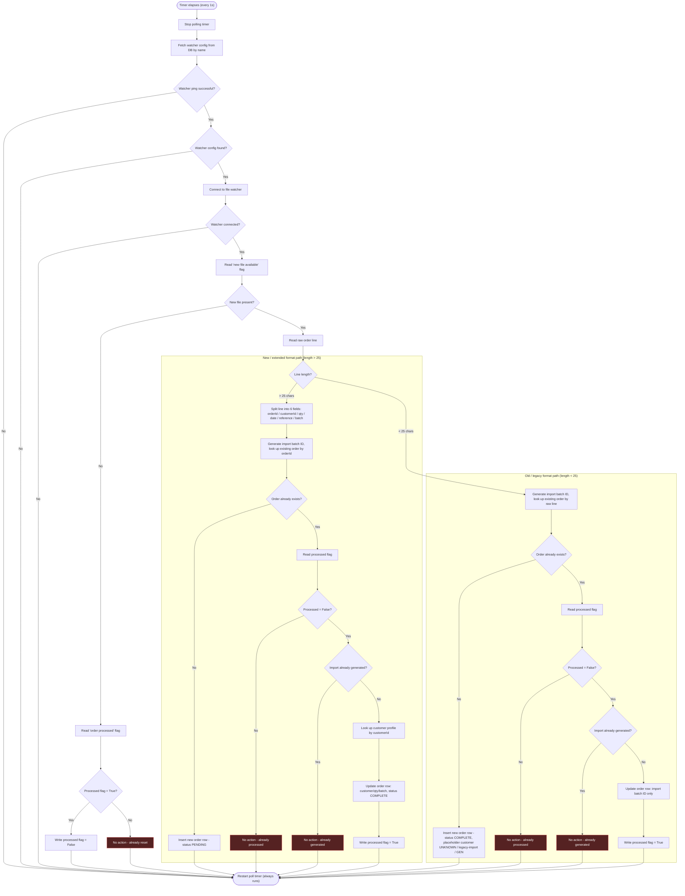

# code-to-flowchart

An AI coding agent skill that traces a function's control flow (branches, decisions, error paths) and turns it into a Mermaid flowchart. Language-agnostic: works the same on a large, high-complexity method in C#, Python, Go, Java, Rust, JS, or anything else with branches and error handling. Built to explain that kind of method to a team without making everyone read it line by line.

Unlike asking a model to "just draw a diagram of this code," the skill enforces a fixed process:
- trace every decision point and side effect, in order
- collapse straight-line logic into named steps instead of one node per line, so the node count scales with complexity, not line count (a 500-line function might collapse to ~15-30 nodes)
- keep error/failure paths visible instead of merging them into the happy path
- write a plain Markdown file with a fenced `mermaid` block. Renders natively on GitHub, GitLab, and most editors, no extra tooling needed

## Install

`SKILL.md` follows the [Agent Skills standard](https://github.com/anthropics/skills), so the same file works unmodified across every tool that supports it:

**Claude Code, Codex, Vibe, Amp, GitHub Copilot CLI**

```bash
mkdir -p ~/.claude/skills/code-to-flowchart   # or ~/.codex/skills/... , ~/.vibe/skills/...
cp SKILL.md ~/.claude/skills/code-to-flowchart/SKILL.md
```

It's a model-invoked skill (no `disable-model-invocation` flag), so the agent picks it up when you ask to visualize code, map a control flow, or explain a branchy function. No slash command needed. You can also invoke it explicitly.

**Cursor**

Cursor doesn't read `SKILL.md`. It uses its own project-scoped rules format. Use [`cursor/code-to-flowchart.mdc`](cursor/code-to-flowchart.mdc) instead:

```bash
mkdir -p .cursor/rules
cp cursor/code-to-flowchart.mdc .cursor/rules/code-to-flowchart.mdc
```

Same steps and completion criterion, translated to Cursor's rule frontmatter.

## Example

```
> convert the OrderProcessor.Process method into a flowchart
```

produces `docs/diagrams/Process-flowchart.md` with a Mermaid diagram tracing every `if`/`else`, DB/IO call, and catch block in that method, grouped into named steps.

### Before / after

**Before**: [`examples/before/OrderImportWorker.cs`](examples/before/OrderImportWorker.cs) — a representative "god method": a self-re-arming polling timer handler with a device-connectivity check, a presence check, and a duplicated old-format/new-format branch. Same shape you'll find in most legacy polling services, regardless of language. Full file is 235 lines; most of the difference is near-per-statement `try/catch` blocks, omitted below for readability:

```csharp
public void ProcessNextBatch(object sender, EventArgs args)
{
    try
    {
        _pollTimer.Stop();
        var config = ConfigRepository.GetWatcherConfigByName("INCOMING_ORDERS");
        _pingStatus = CheckWatcherPing();

        if (_pingStatus == true)
        {
            if (config != null)
            {
                _connection = ConnectToWatcher(config.WatcherUrl);

                if (_connection != null && _connection.State == "CONNECTED")
                {
                    string newFileFlag = ReadFlag("NEW_FILE_AVAILABLE");

                    if (newFileFlag == "True")
                    {
                        string rawLine = ReadFlag("ORDER_LINE").Trim();

                        if (rawLine.Length > 25 && rawLine != "ERROR")
                        {
                            // ---- New / extended format: split into 6 fields, look up
                            // existing order, insert or update, write processed flag ----
                        }
                        else if (rawLine.Length < 25)
                        {
                            // ---- Old / legacy format: same lookup/insert/update shape,
                            // fewer fields, different placeholder defaults ----
                        }
                    }
                    else
                    {
                        // No new file — reset the processed flag if it's stuck set.
                    }
                }
            }
        }
    }
    finally
    {
        _pollTimer.Start(); // always restarts, regardless of which path was taken
    }
}
```

**After**: the skill traces every branch above — including the two collapsed format-handling blocks — into this:



235 lines of nested conditionals and duplicated logic become a 30-node diagram where the format-branch duplication and every error/no-action path are visible at a glance — no tracing required. Full source and full output: [`examples/before/OrderImportWorker.cs`](examples/before/OrderImportWorker.cs) / [`examples/after/OrderImportWorker-flowchart.md`](examples/after/OrderImportWorker-flowchart.md).

## License

MIT. See [LICENSE](LICENSE).

## v3: Function scopes, parameter lineage, token telemetry

The fork adds a reviewed, source-pinned analysis workflow with expanded function scopes, `P:`/ `Δ:` causality annotations, an offline interactive viewer, compact IR serialization, incremental rendering and model-usage logging. See [v3 guide](docs/FUNCTION_SCOPES_README.md) and [public example](examples/sample_flow.json).
