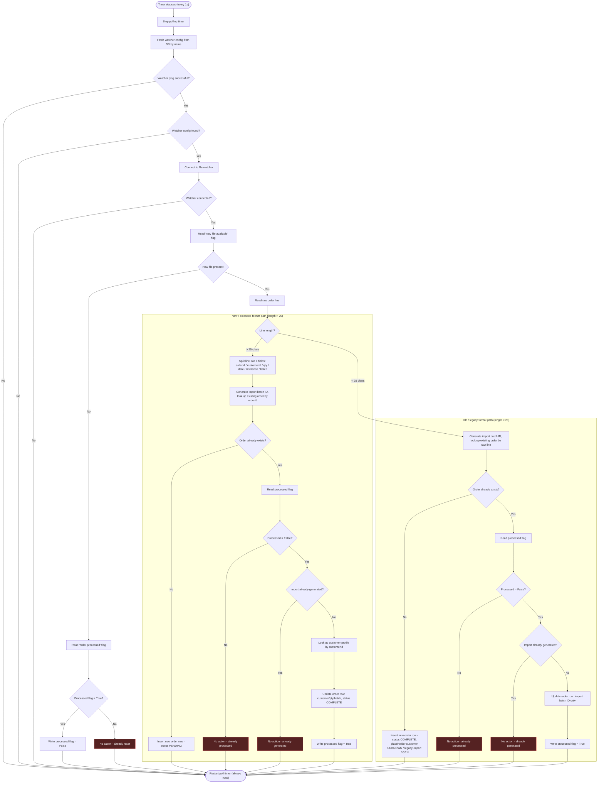

# Flowchart: OrderImportWorker.ProcessNextBatch (example)

Traced from [`examples/before/OrderImportWorker.cs`](../before/OrderImportWorker.cs) — a fictional but representative "god method": a self-re-arming polling timer whose handler has a device-connectivity check, a presence check, and a format-branch duplication (new vs. legacy order format) that mirror the same shape you'll find in most legacy polling services, regardless of language or domain.

**Note on scope:** the real source wraps nearly every statement in its own `try/catch` that only logs and falls through. Those are omitted below — they don't change the control flow shown here. The outer method-level `try/finally` always restarts the poll timer regardless of which path was taken; that's the shared `Finally` node every path flows into.

**Why two near-identical subgraphs:** the New-format and Old-format branches mirror each other step for step but differ in field lists and insert defaults — the exact kind of structural duplication this skill is built to make visible.

